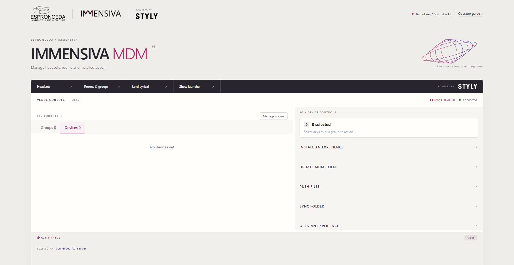
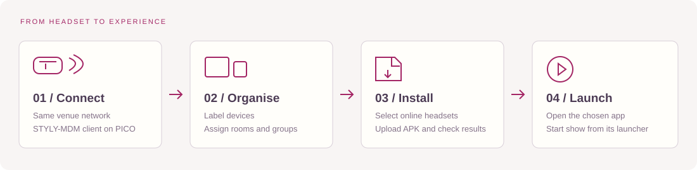
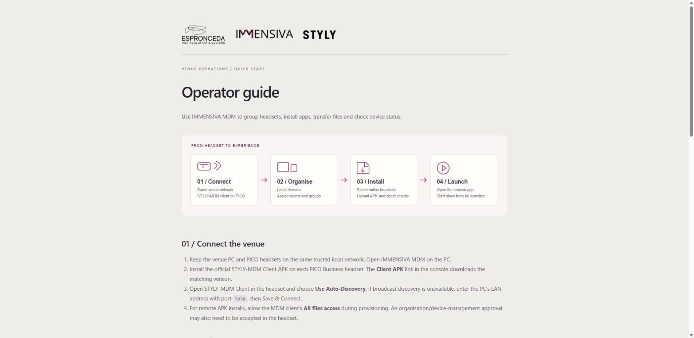

# IMMENSIVA MDM

**ESPRONCEDA / IMMENSIVA headset management, powered by STYLY-MDM.**

Manage headsets, group them by room, install apps and transfer files. Built for ESPRONCEDA / IMMENSIVA using STYLY-MDM.



## Simple operator guide



1. **Open the console.** Extract the complete Windows portable folder and double-click **Start IMMENSIVA MDM.cmd**. The browser opens at `http://127.0.0.1:7070`. Keep this PC awake. Unity is not required.
2. **Connect the headsets.** Put the PC and headsets on the same trusted venue network. Install and open the official [STYLY-MDM headset client](https://github.com/styly-dev/STYLY-MDM/releases/tag/v0.6.0). Use discovery, or enter the venue PC's LAN address and port **7070** in the client. On PICO Business, provision the client permissions including All files access for remote installation. An awake, connected headset should appear in **Your fleet**.
3. **Organise rooms.** Click **Manage rooms**, create groups and assign the intended headsets. Give each headset a clear label. Select a room or individual headsets before sending a command.
4. **Install an experience.** Expand **Install an experience**, choose the Android `.apk`, then install to the selected headsets. Watch the activity log and device results: dispatch is not proof of successful installation.
5. **Open an experience.** Enter its Android package name under **Open an experience**, then **Launch to Selected**. The **Lord Lyrical** shortcut prepares `com.fifthyang.lordlyrical`; it does not select or launch devices automatically. **Show launcher** opens the separate local JERU timing console when available on port 8811. MDM starts apps; it does not synchronise music or show cues.
6. **Finish.** Use **Stop IMMENSIVA MDM.cmd** to stop the server started by this package. Closing the browser alone leaves the server running. Preserve the `MDM` folder when updating: it contains your fleet, groups, uploaded apps and content.

The guide is also available from **Operator guide** in the console (`/guide`).



### If a headset does not appear

- Keep it awake, with STYLY-MDM open. Check the PC address and that both devices are on the same reachable LAN; matching Wi-Fi names alone are not sufficient.
- Venue firewall access: **TCP 7070** for management/transfers and **UDP 7071** for discovery, restricted to the trusted local network. Manual server addressing can help if discovery is blocked.
- Run one discovery server per venue PC. Stop an existing STYLY-MDM server before starting IMMENSIVA MDM on the same ports.
- Inspect `logs/server.log` and the console activity log. A disconnected device will not execute a live launch command.

### PICO LBE maps

IMMENSIVA MDM manages application deployment. Use PICO's Business Device Manager to provision shared LBE maps; this console does not create maps or establish stage alignment. Check physical alignment markers before admitting an audience. JERU retains its own alignment and timing system.

## Run from source

Requires Python **3.11+**. The source repository does not include Python, Unity, headset APKs or venue data.

```powershell
python -m venv .venv
.venv\Scripts\python -m pip install -r requirements.txt
.venv\Scripts\python -m immensiva_mdm.server --port 7070 --data-dir MDM
```

Open `http://127.0.0.1:7070`. Alternatively install the package with `pip install .` and run `immensiva-mdm`. The Windows start/stop scripts use the portable runtime when present, otherwise an installed Python with the dependencies installed.

## Development and architecture

The branding adapter wraps **STYLY-MDM 0.6.0** and preserves its HTTP, admin/device WebSocket messages, UDP discovery, registry, transfer scheduling and Android client protocol. Logos and the venue navigation are served by this package; no vendor source files are rewritten. STYLY-NetSync 0.17.5 is a separate JERU dependency, not the MDM version.

```powershell
.venv\Scripts\python -m pip install -r requirements-dev.txt
.venv\Scripts\python -m pytest tests -q
```

Tests cover branded routes and assets, real WebSocket registration, group-scoped launch with an excluded device, and APK upload/download byte integrity. These are simulated transport checks, not physical headset installation or multi-headset validation. See [delivery checks](docs/VALIDATION.md).

For a distributable Windows folder, run `scripts/build_windows.py --runtime PATH_TO_APPROVED_PYTHON_RUNTIME`. It bundles the runtime plus the application and guide into `dist/IMMENSIVA-MDM-Windows.zip`. Never commit runtime, APKs, credentials, logs or live device registries.

## Network boundary and credits

The upstream console is designed for a **trusted venue LAN**. It provides device administration and is not an authenticated public-cloud service. Do not expose its ports to the public internet.

Software: Apache-2.0; see [LICENSE](LICENSE) and [NOTICE](NOTICE). Official logos remain the property of their owners; their provenance and separate rights are in [BRAND_ASSETS.md](BRAND_ASSETS.md). This project is an ESPRONCEDA / IMMENSIVA venue adaptation, not a claim of STYLY endorsement.

## Support

Amb el suport de la Generalitat de Catalunya.


