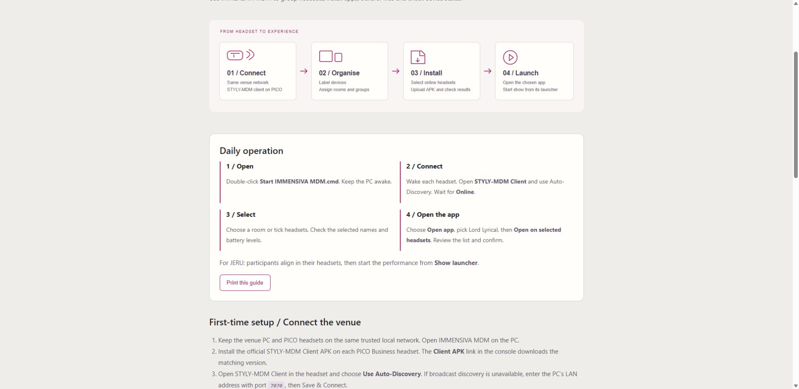
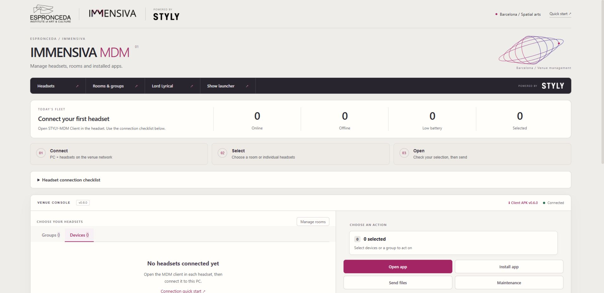

# IMMENSIVA MDM — quick start

For daily operation after a technician has set up the venue network and headset clients.

## 1. Open

Double-click **Start IMMENSIVA MDM.cmd** on the venue PC. Keep the PC awake. The console opens in your browser.

## 2. Connect

Wake each headset and open **STYLY-MDM Client**. Use the venue network and **Auto-Discovery**. Wait for **Online** in the console. If it does not appear, open **Headset connection checklist**.

## 3. Select

Choose a room under **Groups**, or tick individual headsets under **Devices**. Check the selected names and online count. Charge headsets marked low battery before the audience enters.

## 4. Open the app

Choose **Open app** and select **Lord Lyrical**. Click **Open on selected headsets**, review the named headsets, then **Confirm and open**. Check the activity log. For JERU, participants align inside the app; then use **Show launcher** to start the performance.

For another app, choose **Another app…** and enter the package name supplied by your technician. The app must already be installed.

## Install an app

Choose **Install app**, select the `.apk` file supplied by your technician, then **Install to Selected**. Review the headset list and confirm. Wait for each installation result before opening the app.

## End of session

Close the show in its launcher. Use **Stop IMMENSIVA MDM.cmd** when finished with device management. Closing the browser does not stop the server. Keep the `MDM` folder when updating.

## If something goes wrong

| What you see | What to do |
| --- | --- |
| No headsets | Open the client in the headset; check venue network and discovery. |
| Offline headset | Wake it and reopen the client; wait for Online. |
| Button disabled | Select at least one online headset and choose an app/file. |
| Console disconnected | Reopen the console with the Start script; ask the technician if it stays disconnected. |
| Command failed | Read that headset's result in the activity log. Check app installation, client permissions and connection. |
| Low battery | Charge or replace the headset before admitting a participant. |

**Maintenance is for trained staff.** Reboot, shutdown, uninstall, folder mirroring and retirement can interrupt sessions or delete data. The menu is not an access-control boundary; this remains a trusted venue LAN tool.

ESPRONCEDA / IMMENSIVA · Powered by STYLY-MDM

Amb el suport de la Generalitat de Catalunya.

